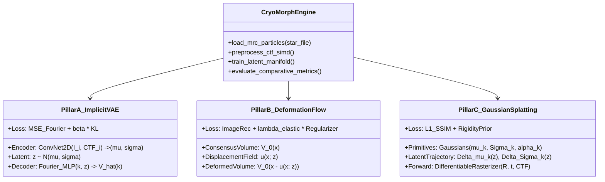

# CryoMorph: Detailed Mathematical & Comparative Architecture Specification

## 1. Mathematical Formulation of the Cryo-EM Forward Problem

Cryo-Electron Microscopy imaging is governed by the **Fourier Slice Theorem** and optical aberrations modeled by the **Contrast Transfer Function (CTF)**.

Given a 3D electrostatic scattering potential $V(\mathbf{x}): \mathbb{R}^3 \to \mathbb{R}$, an experimental 2D projection image $I_i(\mathbf{y})$ is formed according to:

$$I_i(\mathbf{y}) = \mathcal{F}^{-1} \left\{ \mathrm{CTF}_i(\mathbf{k}) \cdot \left[ \mathcal{P}_{\mathbf{R}_i, \mathbf{t}_i} \mathcal{F}(V) \right](\mathbf{k}) \right\} + \eta_i(\mathbf{y})$$

Where:
* $\mathbf{R}_i \in \mathrm{SO}(3)$ is the 3D viewing orientation and $\mathbf{t}_i \in \mathbb{R}^2$ is the in-plane translation of particle $i$.
* $\mathcal{P}_{\mathbf{R}_i}$ extracts a central 2D slice through the 3D Fourier transform of $V$ perpendicular to the projection axis.
* $\mathrm{CTF}_i(\mathbf{k}) = - \sin\left( \pi \lambda |\mathbf{k}|^2 \Delta z_i + \frac{1}{2} \pi C_s \lambda^3 |\mathbf{k}|^4 - \chi_0 \right) \cdot E(\mathbf{k})$ models microscope defocus $\Delta z_i$, spherical aberration $C_s$, wavelength $\lambda$, and envelope attenuation $E(\mathbf{k})$.
* $\eta_i \sim \mathcal{N}(0, \sigma^2)$ is Gaussian noise. Under cryo conditions, the Signal-to-Noise Ratio (SNR) is typically $-10\text{ dB}$ to $-20\text{ dB}$ (noise completely overwhelms signal).

---

## 2. Continuous Conformational Heterogeneity Problem

When a biological macromolecule undergoes structural transitions, the 3D potential is no longer constant, but parameterized by a continuous latent state variable $\mathbf{z}_i \in \mathcal{Z} \subset \mathbb{R}^d$ ($d \ll D$):

$$V_i(\mathbf{x}) = \mathcal{G}(\mathbf{x}; \mathbf{z}_i)$$

CryoMorph directly implements and benchmarks three competing mathematical paradigms $\mathcal{G}_A, \mathcal{G}_B, \mathcal{G}_C$ on the same experimental dataset.



---

## 3. Paradigm In-Depth Breakdown

### Pillar A: Coordinate-Based Implicit Fourier VAE (CryoDRGN Style)
* **Representation:** An MLP acts as a continuous function approximating the 3D Fourier volume $\hat{V}(\mathbf{k}; \mathbf{z}): \mathbb{R}^3 \times \mathbb{R}^d \to \mathbb{C}$.
* **Objective Function:**
$$\mathcal{L}_{\mathrm{VAE}}(\theta, \phi) = \sum_{i=1}^N \mathbb{E}_{q_\phi(\mathbf{z}|I_i)} \left[ \frac{1}{2\sigma^2} \left\| \hat{I}_i(\mathbf{k}) - \mathrm{CTF}_i(\mathbf{k}) \cdot \hat{V}_\theta(\mathbf{R}_i^{-1}\mathbf{k}; \mathbf{z}) \right\|^2 \right] + \beta D_{\mathrm{KL}}(q_\phi(\mathbf{z}|I_i) \,\|\, p(\mathbf{z}))$$
* **Internal Critical Evaluation:**
  * *Strengths:* Can model topological changes (e.g. assembly/disassembly of a subunit).
  * *Failure Mode:* Slices sampled at high frequencies suffer from positional encoding blur and Fourier ringing artifacts; fails to guarantee mass conservation.

### Pillar B: Continuous Deformation Vector Flow Fields (3DFlex Style)
* **Representation:** A static high-resolution consensus potential $V_0(\mathbf{x})$ is deformed by a smooth vector displacement field $\mathbf{u}(\mathbf{x}; \mathbf{z}) \in \mathbb{R}^3$:
$$V(\mathbf{x}; \mathbf{z}) = V_0(\mathbf{x} - \mathbf{u}(\mathbf{x}; \mathbf{z}))$$
* **Objective Function:**
$$\mathcal{L}_{\mathrm{Flow}} = \sum_{i=1}^N \left\| I_i - \mathcal{P}_i \left( V_0(\mathbf{x} - \mathbf{u}(\mathbf{x}; \mathbf{z}_i)) \right) \right\|^2 + \lambda_1 \|\nabla \mathbf{u}\|^2 + \lambda_2 \|\nabla \cdot \mathbf{u}\|^2$$
* **Internal Critical Evaluation:**
  * *Strengths:* Enforces physical realism; conservation of mass is preserved by penalizing divergence $\|\nabla \cdot \mathbf{u}\|^2$.
  * *Failure Mode:* Inability to model "presence/absence" compositional heterogeneity; computationally intensive 3D trilinear volume warping during training.

### Pillar C: Macromolecular Anisotropic 3D Gaussian Splatting (CryoGS Style)
* **Representation:** The 3D density is modeled as a sum of $M$ anisotropic 3D Gaussians:
$$V(\mathbf{x}; \mathbf{z}) = \sum_{m=1}^M \alpha_m(\mathbf{z}) \exp\left( -\frac{1}{2} (\mathbf{x} - \boldsymbol{\mu}_m(\mathbf{z}))^T \mathbf{\Sigma}_m(\mathbf{z})^{-1} (\mathbf{x} - \boldsymbol{\mu}_m(\mathbf{z})) \right)$$
* **Objective Function:**
Differentiable forward projection into 2D Gaussians on the image plane, convolved analytically with CTF in Fourier domain:
$$\mathcal{L}_{\mathrm{GS}} = \mathcal{L}_{\mathrm{Proj}}(I_i, \hat{I}_{\mathrm{GS}}(\mathbf{z}_i)) + \gamma_{\mathrm{clash}} \mathcal{R}_{\mathrm{StericClash}}(\boldsymbol{\mu}(\mathbf{z}))$$
* **Internal Critical Evaluation:**
  * *Strengths:* Orders of magnitude faster forward projection; parameters can be initialized directly from an AlphaFold PDB structure.
  * *Failure Mode:* Susceptible to getting trapped in local minima if initialization is poor; highly sensitive to severe CTF defocus zeros.

---

## 4. Quantitative Comparative Benchmarking Framework

To objectively compare the three paradigms, CryoMorph defines a rigorous automated validation matrix:

| Metric | Definition | Significance |
| :--- | :--- | :--- |
| **Half-Map FSC (0.143)** | Fourier Shell Correlation between independently trained half-set volumes along latent trajectory $\mathbf{z}(t)$. | Resolving power (in Ångströms) of intermediate conformational states. |
| **Mass Conservation Variance** | $\mathrm{Var}_{\mathbf{z}} \left( \int_{\mathbb{R}^3} V(\mathbf{x}; \mathbf{z}) d\mathbf{x} \right)$ | Checks whether physical atoms are magically created or destroyed across the motion trajectory. |
| **Latent Smoothness Index** | Lipschitz continuity of the manifold $\sup_{\mathbf{z}_1, \mathbf{z}_2} \frac{\|V(\mathbf{z}_1) - V(\mathbf{z}_2)\|_{\mathrm{Frobenius}}}{\|\mathbf{z}_1 - \mathbf{z}_2\|}$ | Ensures smooth continuous transitions without sudden teleportation artifacts. |
| **Wall-Clock Throughput** | Particles processed per second during training and volume extraction time per latent frame. | Computational efficiency on standard single/multi-GPU nodes. |

---

## 5. Polyglot Engineering Pipeline

```
[Rust Storage Engine]  --(Shared Memory / C-ABI)-->  [CUDA / Triton Kernels]  <--(PyTorch/Python API)-->  [Julia SciML]
 - MRC/STAR File I/O                                   - Differentiable NUFFT                              - Trajectory ODEs
 - SIMD CTF Math                                      - Fourier Splatting                                 - Free Energy Map
```
